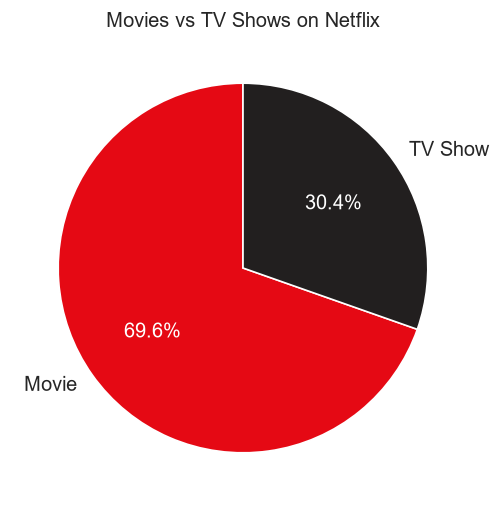
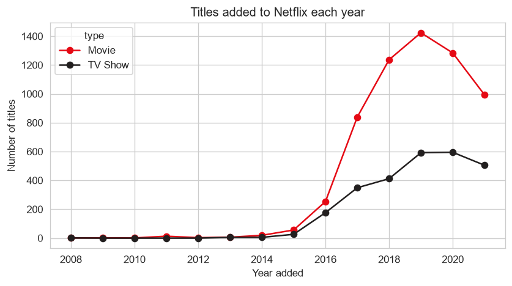
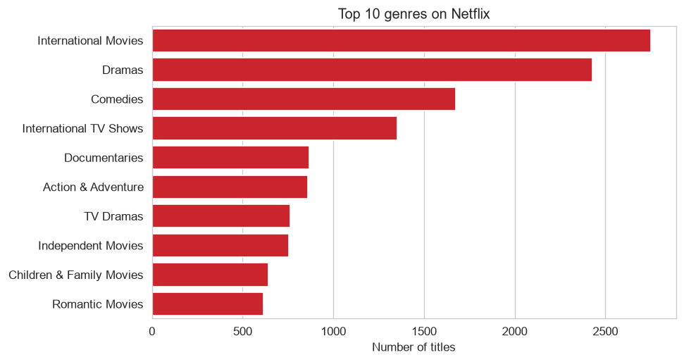
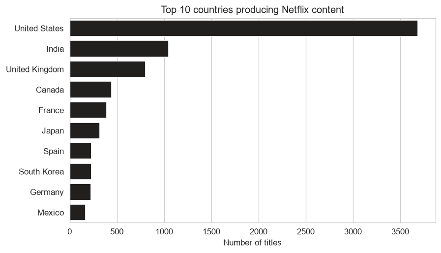
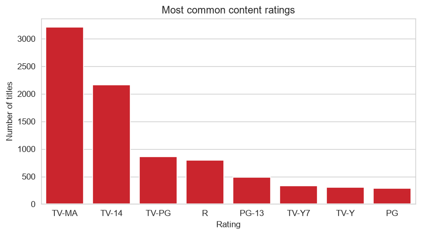
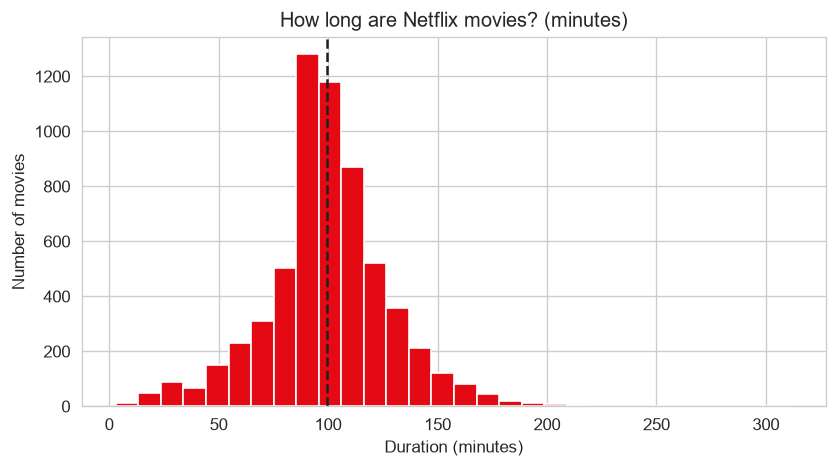

# Netflix Movies and TV Shows - Data Visualization Project

A data visualization project that explores the Netflix catalogue: how much of it is movies versus TV shows, how fast it has grown, which genres and countries dominate, and how long movies run.

**Author:** Anshu | B.Tech CSE, BK Birla Institute of Engineering and Technology
**Course:** Data Visualization Lab

## Goal

Answer five questions with charts:

1. What share of Netflix is movies, and what share is TV shows?
2. How many titles were added each year?
3. Which genres are the most common?
4. Which countries produce the most content?
5. How long is a typical movie?

## Dataset

- **Source:** [Netflix Movies and TV Shows (Kaggle)](https://www.kaggle.com/datasets/shivamb/netflix-shows)
- **File:** `netflix_titles.csv`, placed in the `data/` folder
- **Size:** about 8,800 titles, 12 columns (type, title, director, cast, country, date_added, release_year, rating, duration, listed_in, description)

## Tools used

Python 3, pandas (data cleaning), matplotlib and seaborn (charts)

## Method

1. **Load** the CSV with pandas.
2. **Clean:** remove duplicates, fill missing text values with "Unknown", convert `date_added` to a real date, and pull the number out of `duration` (e.g. "90 min" becomes 90).
3. **Visualize:** draw six charts and save them in `img/`.
4. **Report:** print the key findings.

## Charts

| Chart | Type | Why this type |
|---|---|---|
| Movies vs TV Shows | Pie | Shows parts of a whole (two categories only) |
| Titles added per year | Line | Shows change over time |
| Top 10 genres | Horizontal bar | Compares categories with long names |
| Top 10 countries | Horizontal bar | Compares categories |
| Content ratings | Bar | Compares categories |
| Movie duration | Histogram | Shows how values are spread |








## Key findings

> Replace these with the numbers printed when YOU run the program.

- Movies make up **69.6%** of the catalogue and TV shows **30.4%**.
- The year with the most titles added was **2019**.
- The most common genre is **International movies**, and the top producing country is **United States**.
- The average movie runs about **100 minutes**.

## Limitations

- The dataset is a snapshot, so it shows what was on Netflix when it was collected, not what people watched.
- Many titles have several genres and countries. Each one is counted separately, so the totals are larger than the number of titles.
- Some titles have no country, director or date. Missing countries are left out of the country chart.

## How to run

```
pip install -r requirements.txt
python analysis.py
```

Download `netflix_titles.csv` from the Kaggle link above and put it in `data/` first. The charts are saved in `img/`.

## Project structure

```
netflix-visualization/
├── data/netflix_titles.csv
├── img/                  (charts are created here)
├── analysis.py
├── requirements.txt
└── README.md
```
